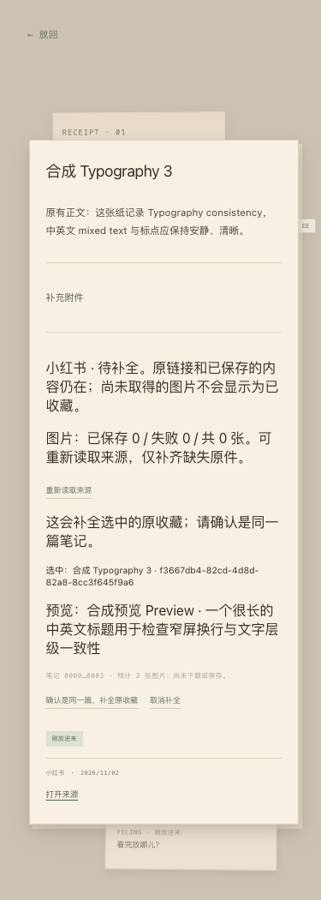
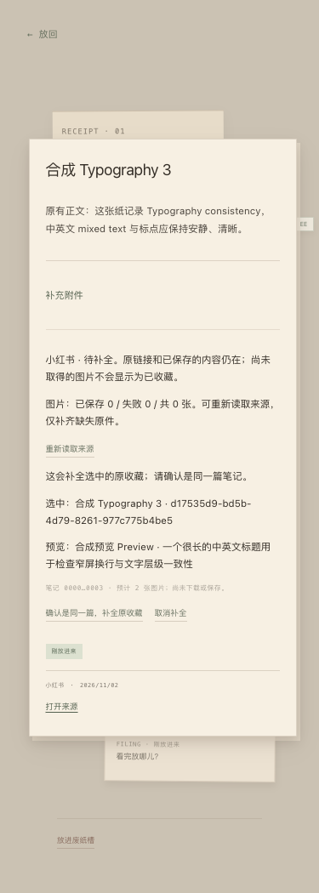
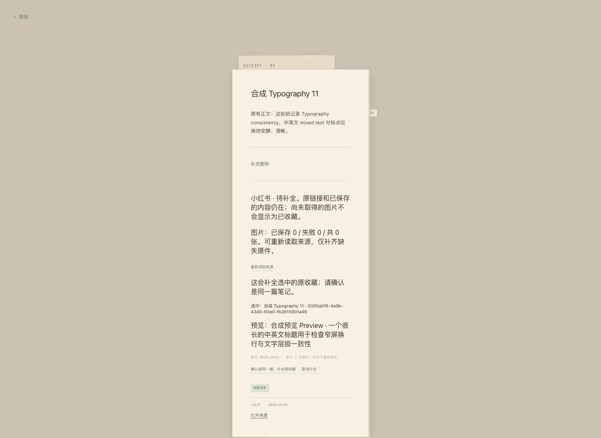
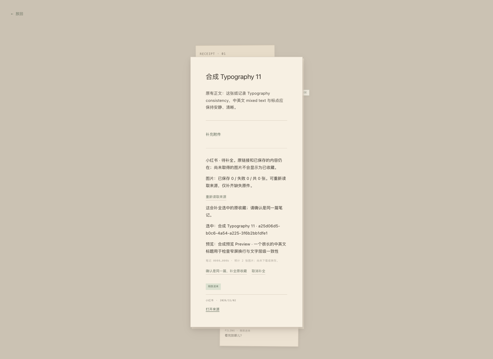
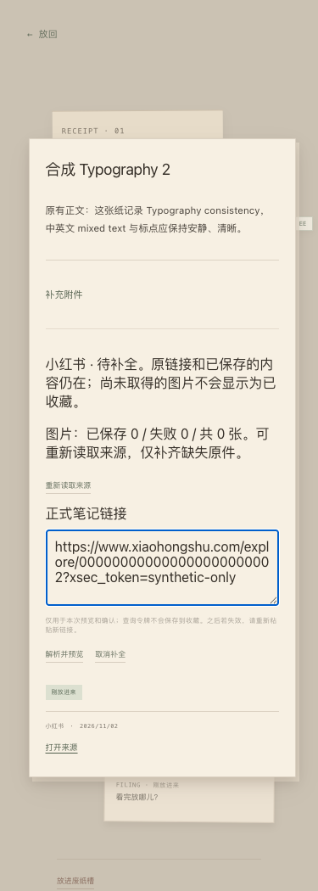
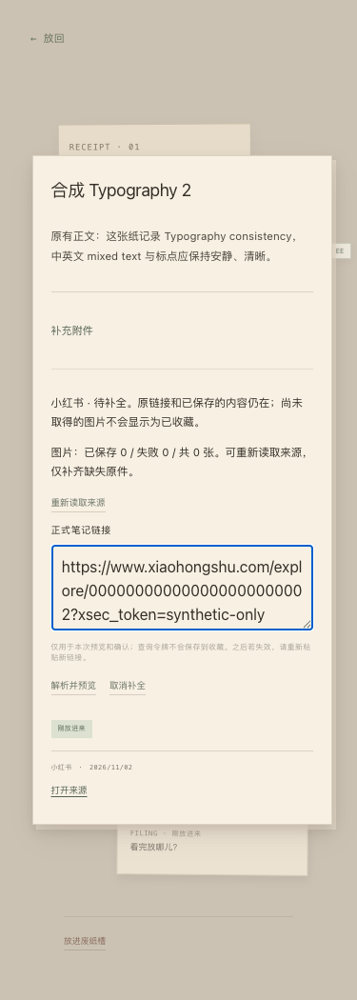
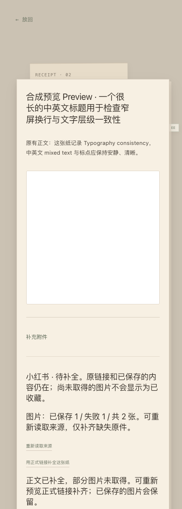
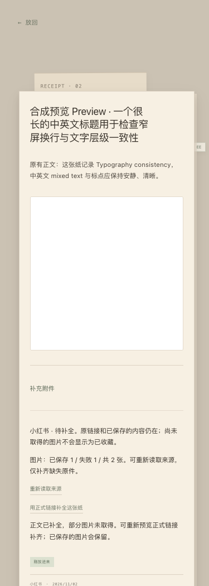

# Typography consistency · UI polish

基线：最新 main `c6957b7c012072851863abe3602eaf4d2f34e14c`（已含上线的 #42）。独立分支，不继续改 XHS 实现。运行日期 2026-11-02（Asia/Shanghai）。所有图片、标题、URL、Store 与截图均为合成测试内容。

## Audit 与决策

根因不是正文设计有误：`OriginalPaper.module.css` 的 `.body` 已有获准的 11.5–11.75px / 1.75 规格，但 `.paper` 根节点只有字体家族，没有正文继承基线。XhsRetry/Canonical 的普通 p、状态、label 继承了浏览器 16px。旧来源操作仅通过 `aria-label="来源内容"` 的局部规则匹配 Inspect 操作字体，新恢复区未命中，使用了另一套 8.96px monospace。嵌套 identity 还定义了独立 `.65rem`，导致错误候选文字脱离 helper 层级。

| Before | After | Why |
| --- | --- | --- |
| XHS 说明/计数/preview/confirmation/status 为 16px | 375px 为 11.5px，桌面为 11.75px；400、1.75、.005em，与相邻原正文一致 | 在纸张根节点提供既有正文基线，覆盖新组件的自然继承，不逐行打补丁 |
| 新入口/按钮 8.96px monospace，旧来源操作 9.5–10px UI 字体 | 使用旧来源操作的同一 Inspect tokens / UI 字体、400、1.4、0 spacing | 新控件应属于原纸张操作层级 |
| label 16px，无上下文层级 | 10px metadata 字体，与既有“补充说明”标签同级 | 提取既有标签规格，无新层级 |
| identity 独立 .65rem，错误候选文字可大于错误说明 | 正常 preview 继承正文；错误候选继承 error helper | 不为内容字符串另立尺寸规则 |
| textarea 依赖 16px 根字号偶然继承，placeholder 未明确继承 | 复用既有 `--paper-type-input-size`（16px）及表单正文 tokens；placeholder 同步 | 保留既有移动表单层级，不把输入框当作 helper 缩小 |
| 普通段落只能依赖局部 selector，后续新增容易复发 | `--inspect-type-*` 提取原有精确值，`.paper` 提供正文继承；已有 body/source/action 均引用同一值 | 不复制字号，不用 !important，不强行使用规格不同的通用小纸张正文 token |

已阅读/审查：XhsRetryPanel、XhsCanonicalPanel、InspectOriginalPaper、SourceReadPanel、InspectAttachments、InspectMedia，以及相邻 EE Note / Record / FilingSlip / TagEditor / Capture 与独立 Type Cabinet 的 CSS role。TSX 和业务逻辑全部未改。

相邻模块结论：文档专用标题、附件名称/微型元数据/11px feedback、独立字体衣柜表单等都有明确上下文层级；EE Note/Record/Filing/Tag 的小纸张角色使用现有 `--paper-type-*`。它们不是 16px 无意继承的同一问题，本轮保留，未把整站强制统一成 Inspect 字号。既有 Inspect 标题、文档说明、footer 和 metadata 层级不重设计。

## 修改文件

- `frontend/src/styles/tokens.css`：只提取原有 Inspect body/action/label 值；通用 paper tokens 不变。
- `frontend/src/features/inspect/OriginalPaper.module.css`：根纸张正文基线；原 body、来源正文、来源操作和标签引用提取的 token。
- `frontend/src/features/source-reading/SourceReadPanel.module.css`：来源控件、label、input/placeholder 使用所属角色；移除 identity 私有字号，允许长字符串安全换行。保留既有 helper/error 及 micro metadata 尺寸，metadata 的 normal 行高显式保留。
- `docs/REFERENCE_LIBRARY.md`：增加 **Typography Inheritance Rule**，要求先识别区域角色、复用 tokens/classes，新增层级必须说明理由与非重复性。
- `tools/typography-ui-audit.mjs`：仅本地合成 UI 的可复跑检查工具，不是产品入口。

## 实际浏览器证据

Chrome/Chromium，375×1050 与 1440×1050，DPR 1。每个宽度实际点击 8 个状态：collapsed、input、preview、confirming、partial、error、success、retry，总计 16。before 是未经样式修改的 main 静态构建，after 是本轮构建；不是通过 DevTools 临时覆盖生成的假对照。

实际比较相邻原正文与新说明的 family / size / weight / line-height / letter-spacing；新操作与原 footer“打开来源”同样逐项比较。16 组中，原正文与原来源操作的全部上述属性前后均未改变。after 全部无横向溢出。textarea 与 placeholder 同字体/16px；另验证自定义 Inspect reading/UI 字体覆盖继续被继承。包含中英文、长标题、UUID、URL 换行、错误/helper、partial 真实计数。成功状态按实际产品行为退出恢复区，展示原正文和保存附件，未伪造成功文案。

| 对照 | Before | After |
| --- | --- | --- |
| 375px preview，与上方原正文比较 |  |  |
| 桌面 preview |  |  |
| 375px label / input |  |  |
| 375px partial |  |  |

完整 16 场景的字体数据：[metrics.json](typography-evidence/metrics.json)。其余 error/success/confirming/retry 截图保留在本地 `/tmp/aqi-typography-evidence-20261102`，不含真实内容。

## 测试回执

| 命令 | 退出码 / 结果 |
| --- | --- |
| npm ci --offline --ignore-scripts | 0 |
| npm run frontend:check | 0；lint + TypeScript + production build |
| npm run build --workspace=frontend -- --base=/drawer-next/ | 0；实际 UI 静态构建 |
| before / after typography-ui-audit.mjs | 各退出 0；各 16 场景，after 有字体继承/placeholder/换行断言 |
| before / after 原正文及旧操作字体数据比较 | 0；16/16 不变 |
| npm run check | 0；265 PASS / 0 FAIL / 1 SKIP；smoke、XHS、Vault 集成通过 |
| node --check tools/typography-ui-audit.mjs / git diff --check | 0 |

1 SKIP 是本机缺少 Poppler 的 PDF E2E，不是 Typography 测试跳过。浏览器/本地服务器/临时 Store 在 finally 中清理，只保留合成截图。

复跑：用 `--base=/drawer-next/` 构建，将 frontend/dist 复制到未跟踪的 react-dist；设置本地 `XHS_PLAYWRIGHT_MODULE`、可选 `XHS_BROWSER_EXECUTABLE` 后执行 `TYPOGRAPHY_PHASE=after TYPOGRAPHY_OUTPUT=/tmp/... node tools/typography-ui-audit.mjs`。before 应在未修改的基线构建执行；此模式只采集基线，不声称旧样式符合继承断言。

边界：没有改 TSX/controller、XHS 抓取/图片下载、Store、MCP、授权、API 或数据处理。不是物理手机 Safari/真实 Host 验收；没有声称修复所有独立产品界面的一切既有字体差异。保持 Draft，不 merge/deploy，不操作 Tokyo 或私人收藏，等待 EE／阿栖验收。
